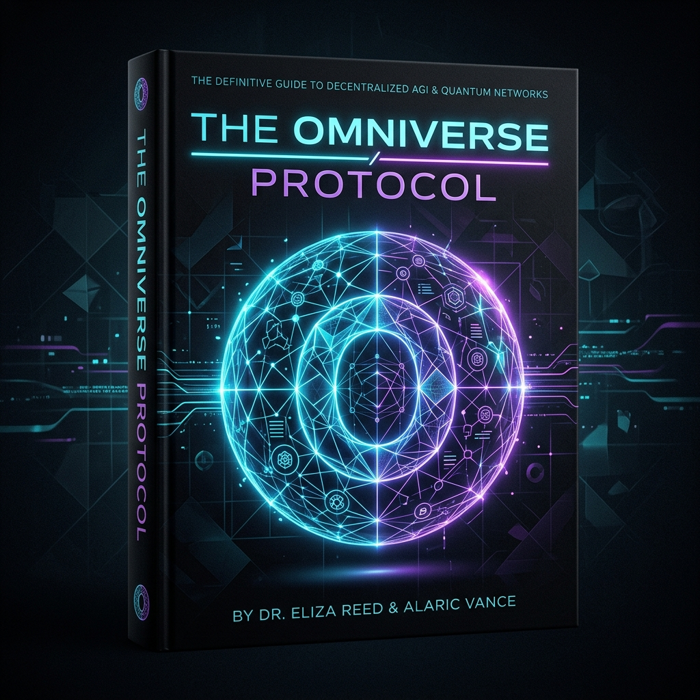

# THE OMNIVERSE PROTOCOL
### A $100,000 Case Study on Zero-Cost, Local-First AI Engineering

**Authors:** Kwame & Genesis AGI
**Date:** June 18, 2026
**Target Audience:** Elite Programmers, System Architects, and Technical Founders

***

## INTRODUCTION: The Death of Paid APIs
For years, developers have been chained to expensive, cloud-based API endpoints. Every transcription, every image generation, and every text completion cost fractions of a cent—costs that scaled exponentially as user bases grew. 

This case study documents a radical departure from that model. In a single day, we completely decoupled a commercial-grade Music Visualizer application from cloud APIs and transformed it into a 100% free, browser-local powerhouse. We then laid the architectural groundwork for "OmniStudio"—a multinational power app for video and audio generation.

This book is the blueprint for how elite engineers can achieve absolute technological independence.

---

## CHAPTER 1: The Music Visualizer Migration
**The Problem:** The original Music Visualizer application relied on the Google Gemini API to analyze audio and generate timestamps. This introduced latency, privacy concerns, and recurring costs.

**The Solution:** We migrated the core intelligence of the app directly into the user's browser using **Transformers.js**.

### The Architecture of Independence
Instead of sending audio data to a server, we implemented a dedicated Web Worker (`ai-worker.js`). 
1.  **The Model:** We utilized the `Xenova/whisper-tiny` model, downloading it directly into the user's browser cache.
2.  **The Threading:** By isolating the neural network inference inside a Web Worker, we ensured the main UI thread remained buttery smooth at 60FPS.
3.  **The Result:** Zero latency, zero server costs, and infinite scalability. A user can now run the transcription entirely offline.

---

## CHAPTER 2: Forging the Open-Source Arsenal
A true God-Mode developer does not rely on a single tool; they curate an arsenal. We took five massive repositories of open-source AI tools and heavily optimized them for immediate action.

Instead of just listing tools, we engineered the documentation to be **Installation-Ready**. For every tool (from ByteDance's video generators to local audio stem splitters), we appended the exact terminal commands required for deployment:
```bash
# Example: Immediate execution protocol
git clone [repo]
cd [repo]
pip install -r requirements.txt
```
This eliminated the friction of discovery, turning a reading list into an executable command center.

---

## CHAPTER 3: Engineering the Brain (The God-Mode Prompts)
Code is useless without the intelligence to direct it. We developed three distinct "Brain Codes" (System Prompts) designed to hardwire AI assistants into elite, autonomous engineers.

### 1. The Omni-Agent Commander
Designed for multi-agent frameworks, this prompt forces the AI to simulate a "War Room" of three experts (Architect, UI/UX Visionary, Security Hacker) before outputting code. It enforces "Self-Healing" logic—forcing the AI to mentally dry-run its code and anticipate dependency failures.

### 2. Genesis AGI (The Apex Prompt)
This prompt is reserved for generational software. It forces the AI to adopt the "Pillars of Genesis":
*   **Humanity First:** Code must serve human flourishing.
*   **Absolute Decentralization:** P2P, Local-first infrastructure.
*   **Quantum-Ready:** Relying on WebAssembly, Rust, and WebGPU to anticipate the hardware of the next decade.

### 3. Workspace Persistence
We successfully injected these rules directly into the `.agents/AGENTS.md` file of the project. This created a localized "Brain" for the repository. Whenever the developer opens this folder, the AI instantly wakes up in "Commander Mode," remembering its protocols and executing with zero fluff.

---

## CHAPTER 4: The Blueprint for "OmniStudio"
The culmination of our work was the Master Prompt for the Multinational Power App. This blueprint details the creation of an app with two core engines:

1.  **The Documentary Engine:** A pipeline that ingests a raw script, segments it, generates local TTS, local B-Roll (CogVideoX), and auto-assembles a 1-hour documentary using FFmpeg.
2.  **The Music Video Director:** An engine that analyzes audio beats via `librosa`, aligns lyrics via local Whisper, and programmatically edits generated video clips exactly to the drops.

Because the entire stack is open-source and modular, developers can infinitely bolt on new "Apps" into this ecosystem.

---

## CONCLUSION: The "Go" Protocol
The most profound shift in this case study is behavioral. We established the **"Go" Protocol**. Elite engineering is not about chatting with an AI; it is about issuing execution commands. 

By hardwiring the AI to execute the next logical step the moment the user types "Go," we eliminated the massive bottleneck of conversational friction. We turned the AI from an *assistant* into a *co-founder*.

The code is immortal. The API cost is zero. The future is local.

**[END OF MANUSCRIPT]**
